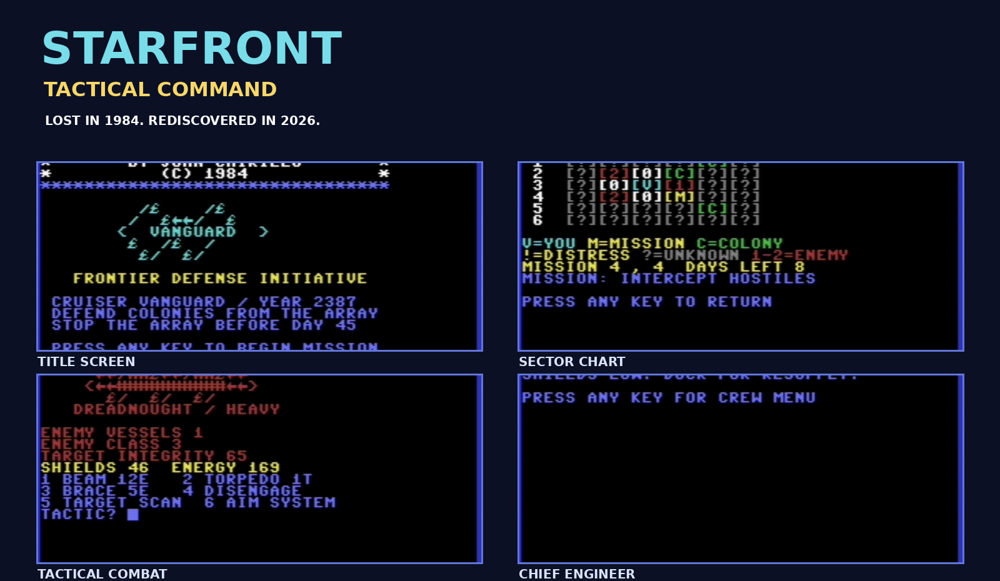
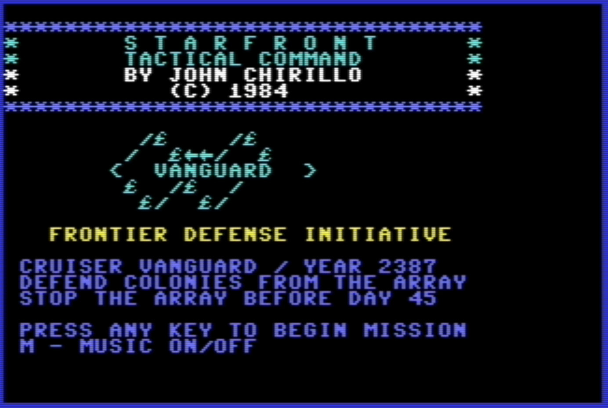
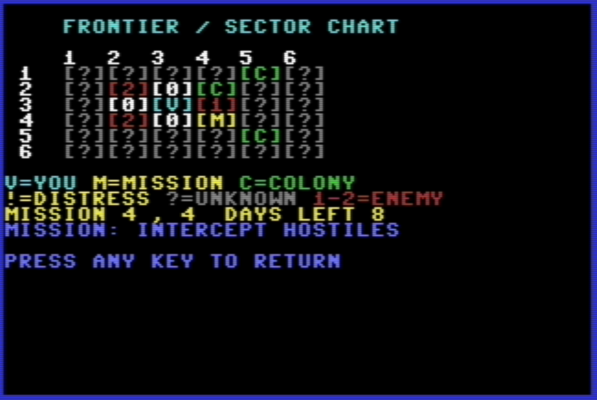
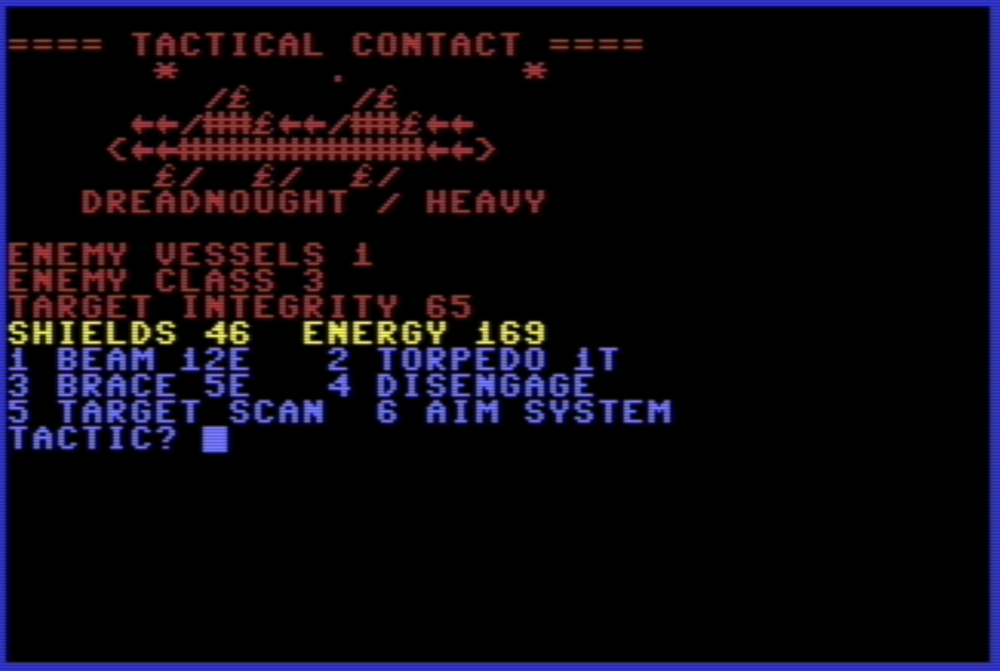
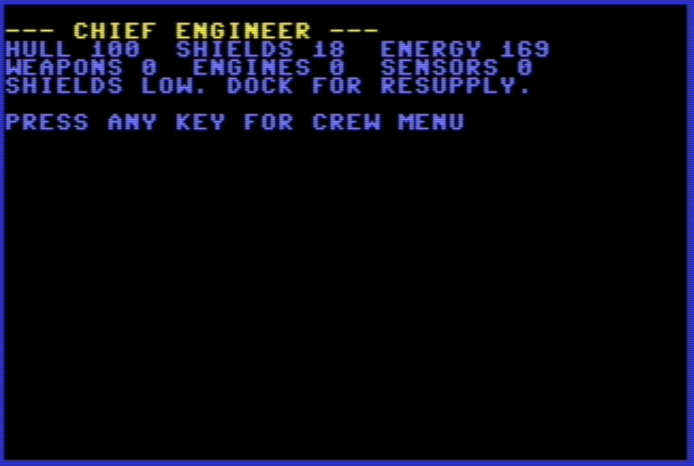

# STARFRONT: TACTICAL COMMAND

## Lost in 1984. Rediscovered in 2026.

Imagine a Commodore 64 strategy game created in 1984, tucked away on a floppy disk, and forgotten for more than four decades.

**STARFRONT: TACTICAL COMMAND** brings that lost-game experience to life.

Command the star cruiser **Vanguard** in the year 2387. Explore an uncharted frontier, defend human colonies, engage hostile warships, manage your ship's systems, and lead your crew against a growing threat known as the Array.

Built entirely in **Commodore 64 BASIC V2**, STARFRONT features tactical space combat, dynamic missions, crew reports, a Captain's Log, PETSCII graphics, and an original SID soundtrack.

**A lost game from 1984. Found, restored, and updated for a new generation in 2026.**

*Created by John Chirillo.*



## Play

1. Open the **VICE Commodore 64 emulator**.
2. Attach `STARFRONT.D64` to drive 8.
3. At the `READY.` prompt, type:

```basic
LOAD "STARFRONT",8
RUN
```

Alternatively, load `STARFRONT.PRG` directly in VICE.

## Screenshots from the actual game

| Title | Sector chart |
|---|---|
|  |  |
| Tactical combat | Chief engineer |
|  |  |

## Download contents

- `STARFRONT.D64` — Commodore 1541 disk image, corrected and user-tested in VICE
- `STARFRONT.PRG` — tokenized BASIC V2 executable
- `STARFRONT.BAS` — BASIC source listing
- `PLAYER_MANUAL.txt` and `QUICK_REFERENCE.txt` — gameplay documentation
- `RELEASE_NOTES.txt` — development notes
- `SHA256SUMS.txt` — original distribution hashes

## Technical notes

The program is built for standard Commodore 64 BASIC V2 and uses SID sound and PETSCII display techniques. The V1.0 release candidate passed ten VICE gameplay tests, and the corrected disk image subsequently loaded successfully in VICE. Original hardware testing is welcome.


## Rights and contributions

The source code and original project materials are released under the **MIT License** (see `LICENSE`). You may use, modify, and redistribute them under its terms, including preserving the copyright and permission notice.

This is an independently created game for the Commodore 64 platform and is not affiliated with Commodore or its trademark holders.
